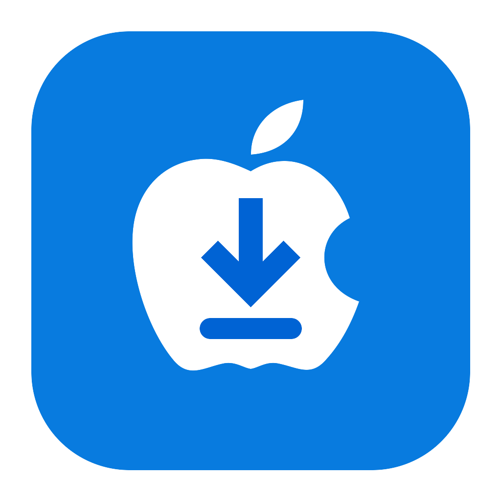

<div align="center">



# Mac Downloader

A fast, quiet download manager for macOS, built in Rust.

**English** · [العربية](README.ar.md)


[Download the latest release](https://github.com/jawaddepp/mac-downloader/releases/latest)

</div>

---

Mac Downloader splits files across many connections, resumes where it left
off, and takes downloads and videos straight from your browser. It is designed
to feel at home on the Mac: one toolbar, a quiet sidebar, a compact progress
window, Light and Dark appearance, and full keyboard and VoiceOver support.

## Features

| | |
|---|---|
| **Fast, resumable downloads** | Up to 32 connections per file. Pause and resume at any time, even after quitting. A dropped connection waits and continues by itself. |
| **Browser companion** | An extension for Chrome, Edge, Brave and Opera sends downloads to the app, and adds a small video button that lists every available quality with its file type, audio and size. |
| **Video and audio** | Streaming video (HLS), separate video and audio tracks merged automatically, playlists, and MP3 conversion (with the optional tools below). |
| **Organized library** | Downloads sort themselves into categories and folders by file type. Search, filter by category or queue, and switch between a compact list and a detailed table. |
| **Queues and scheduling** | Queues with their own order and limits, a scheduler, and actions when everything finishes (sleep, shut down, quit). |
| **Control** | A global speed limit or one per download, download quotas, proxy settings, and site logins protected with a key in your login Keychain. |
| **More ways to add** | Batch links, numbered address patterns (`img*.jpg`), a site grabber, torrents and magnet links, and import/export of download lists. |
| **Background mode** | Keeps running in the menu bar when the window is closed, and can start quietly when you sign in. |
| **Eight languages** | English, العربية, Français, Español, Deutsch, Português, Türkçe, Русский. |

## Install

1. Download `MacDownloader-macos-arm64.dmg` from the
   [latest release](https://github.com/jawaddepp/mac-downloader/releases/latest)
   for Apple Silicon Macs (M1 and later).
2. Open the disk image and drag **Mac Downloader** to **Applications**.
3. Open it from Applications.

The app has an ad-hoc signature, not an Apple Developer ID signature or
notarization. If macOS blocks the first launch, open
**System Settings → Privacy & Security** and choose **Open Anyway**.
Each release lists a SHA-256 checksum for every file.

Regular downloads need nothing else. For video, audio and torrents, install
the helper tools with [Homebrew](https://brew.sh):

```sh
brew install yt-dlp ffmpeg aria2
```

Mac Downloader finds tools in `/opt/homebrew/bin` and `/usr/local/bin`, even
when it is opened from Finder. Update them with `brew upgrade`.

## Connect your browser

Choose **Help → Add Mac Downloader to my browser…** and click
**Start Setup…**. The assistant prepares a permanent copy of the extension,
opens the right browser page, selects the folder in Finder, and shows
**Connected** once the extension reaches the app.

- Chrome, Edge, Brave and Opera are supported. Turn on **Developer mode** on
  the extensions page, then drag the **Mac Downloader Extension** folder onto it.
- Firefox needs a signed add-on matching the app version to stay installed;
  otherwise it is loaded temporarily until Firefox quits.
- Safari is not supported.
- Protected (DRM) video, such as Netflix, cannot be saved. The extension says
  so instead of saving short fragments.

Keep the prepared folder where it is: the app updates it in place. A folder
prepared by an earlier version (named *Ezoo Download Extension*) also stays
in place, because browsers load unpacked extensions by their path.

## Background and sign-in

- **Keep running in the menu bar when the window is closed** leaves downloads
  going after you close the window. The menu bar item offers Show Mac
  Downloader, New Download, Settings and Quit.
- **Launch Mac Downloader in the background when I sign in** starts the app
  quietly at sign-in through a LaunchAgent. Move the app to Applications before
  turning this on.
- While the main window is visible, progress appears in the list. When it is
  hidden, a compact progress window can appear instead (Settings → Downloads →
  Background progress window).

## Privacy and network behavior

Mac Downloader collects no analytics and sends no usage data anywhere.

| | |
|---|---|
| **Browser connection** | A local server on `127.0.0.1` (port 9614 by default) for the extension. It refuses web-page origins, CORS preflights and foreign host names. It is not an authentication system for local processes. |
| **Cookies** | The extension sends only the cookies and page address of the file being downloaded, so links that need a sign-in work. They stay on your Mac. |
| **Clipboard** | Watching the clipboard is off by default and nothing is read while it is off. |
| **Credentials** | Passwords and cookies saved by the app are encrypted (AES-256-GCM) with a key in your login Keychain. If the Keychain can't be opened, saved data is never replaced with empty values. |
| **Downloaded files** | Finished files keep the quarantine attribute, so macOS still knows they came from the internet. |
| **Updates** | Help → Check for updates opens the releases page. The app does not update itself on macOS. |

## Data locations

These names come from the app's first releases and are kept so existing
downloads, settings and sign-in items continue to work:

| | |
|---|---|
| Settings and download list | `~/Library/Application Support/com.Ezoo.EzooDownload` |
| Sign-in item | `~/Library/LaunchAgents/com.ezoo.EzooDownload.plist` |
| Bundle identifier | `com.ezoo.EzooDownload` |

## Build from source

Requirements: [Rust](https://rustup.rs) (stable), Apple's Command Line Tools
(`xcode-select --install`) and Python 3.10 or later (used only to build the
disk image, in an isolated environment under `build-cache`).

```sh
./build-macos.sh
```

This builds an optimized native app at `dist/macos-arm64/Mac Downloader.app`
(or `macos-x86_64` on Intel), plus a DMG, a ZIP and a SHA-256 file for each in
`dist`. To build for a specific architecture:

```sh
rustup target add aarch64-apple-darwin
./build-macos.sh --target aarch64-apple-darwin
```

Use `--debug` for a development build and `--skip-build` to package an
existing build. The minimum macOS version is 11; change it with
`MACOSX_DEPLOYMENT_TARGET`.

### Tests

```sh
cargo test --workspace
node extension/test/yt-core.test.js
node extension/test/background.sim.js
node extension/test/ui-contract.test.js
node extension/test/content-widget.test.js
```

`extension/test/popup-preview.html` and `extension/test/widget-preview.html`
render the real extension code with sample data (serve the `extension` folder
with any static server; add `?theme=dark` or `?state=…`).

To try the app with separate data, set `EZOO_DATA_DIR` to an empty folder
before launching it. Your usual downloads and settings are then left alone.

## Project structure

```
crates/engine/      download engine (HTTP, HLS, DASH, torrents, queues, settings)
crates/app/         the app (Rust + Slint)
  ui/               windows and the shared design system (common.slint)
  lang/             translations
extension/          browser extension (Chrome, Edge, Brave, Opera, Firefox)
docs/redesign.md    design system, feature inventory and compatibility notes
build-macos.sh      app bundle, DMG and ZIP
```

The repository also keeps the Windows build scripts and installer from the
original project; Windows builds are not published in this repository's
releases.

## Credits

Mac Downloader is based on **Ezoo Download** by **Ahmed Ezzat**
([original project](https://github.com/AhmedEzo686/ezoo-download)).
The interface was redesigned for macOS in version 1.1.0.

Copyright © 2026 Ahmed Ezzat. Open-source components and their licenses are
listed in [THIRD-PARTY-NOTICES.txt](THIRD-PARTY-NOTICES.txt). Respect the
rights and terms of use of any content you download.
